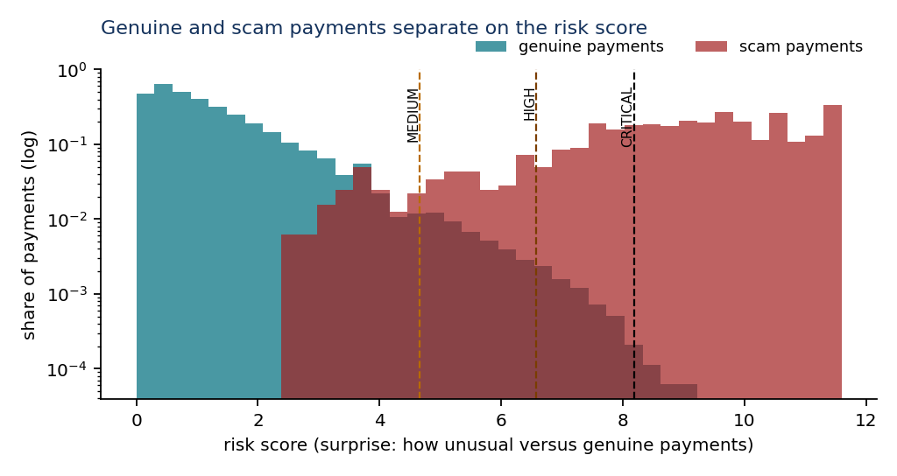
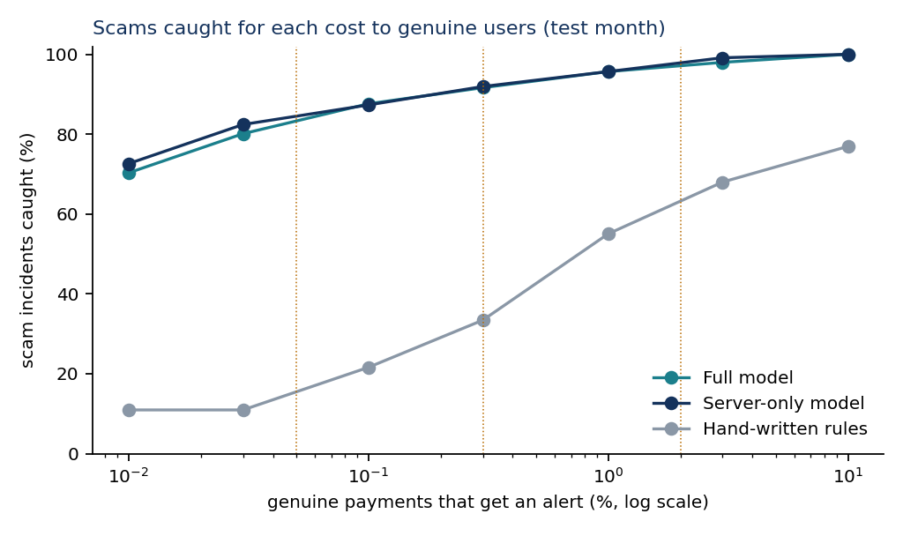
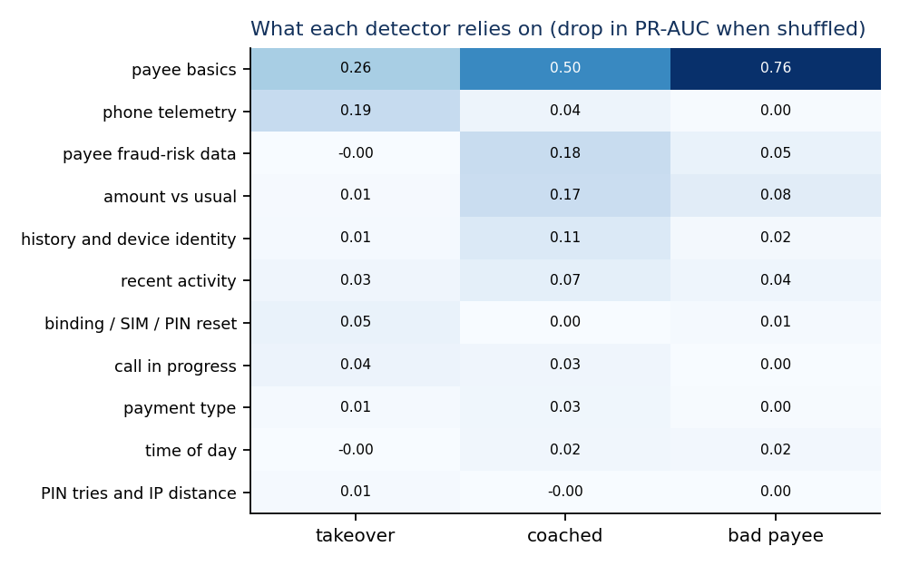
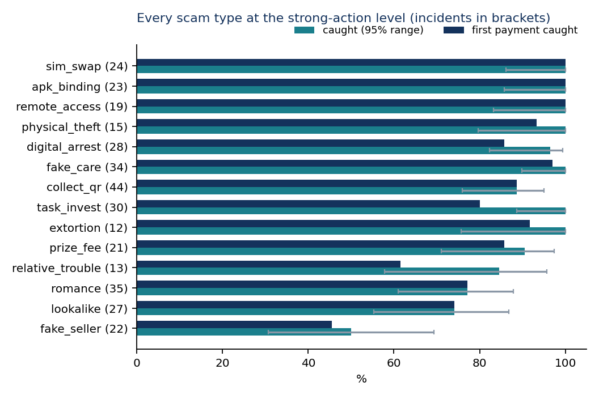
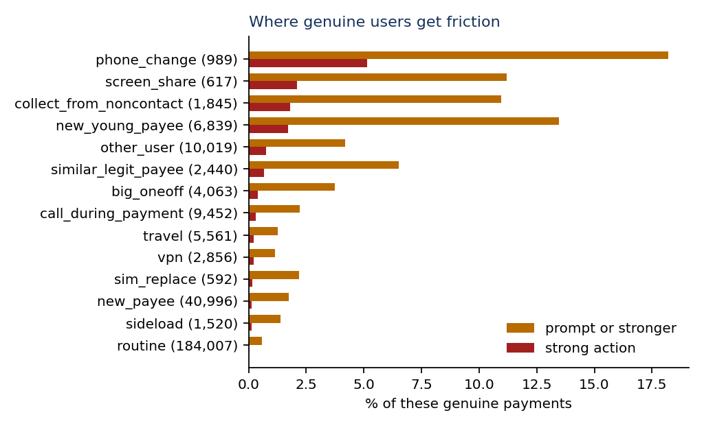
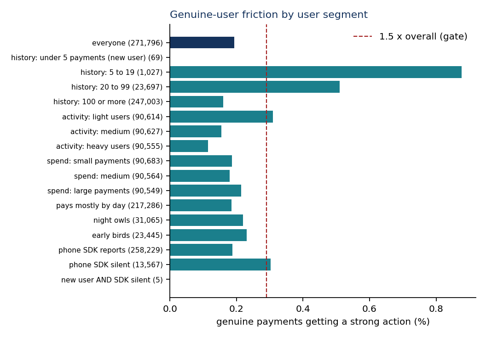
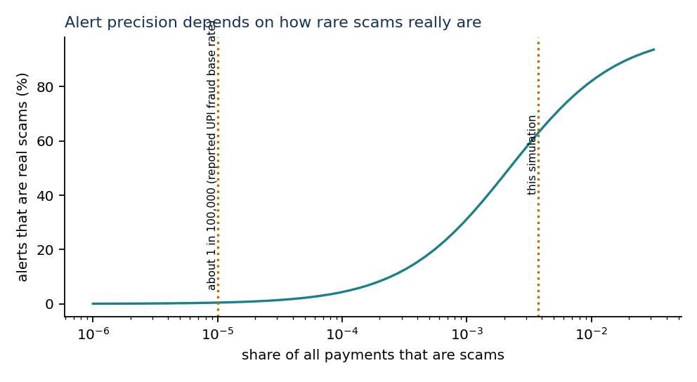
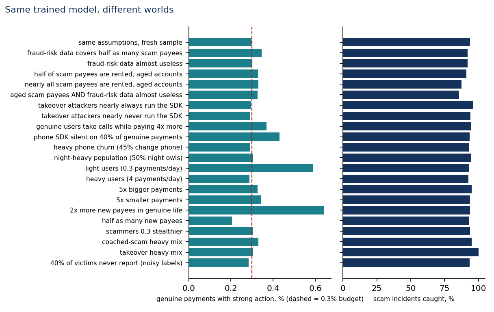

# Evidence report for the payment-risk model (generated by `python -m ato.evaluate`)

Everything here is on **synthetic data**. This report scores the saved model; it does not retrain it. Section 5 explains what this evidence can and cannot say about the real world.

## 1. What the model is, in numbers

- 3 detectors (takeover, coached, bad payee) + a router, on 46 inputs (10 come from the phone's app, the rest from server facts). Trees per detector: {'takeover': 400, 'coached': 400, 'payee': 200}.
- Trained on 755,233 payments (days 0 to 90), tuned on 268,969 (days 90 to 120), tested on 272,875 (days 120 to 150) with 347 scam incidents.
- Strictness (friction budget): at most 2% / 0.3% / 0.05% of genuine payments reach prompt / strong action / block. Saved model size: 1260 KB.
- Speed per payment (3 detectors, router, explanation): 41 ms full, 31 ms server-only.
- This report reproduces the training report's headline exactly: **True**.

## 2. How it predicts

Each payment becomes numbers (amount versus this user's norm, payee age, call in progress, SIM change, and so on). Three detectors each score the payment. Each score is converted to a **surprise**: how rare a score that high is among genuine payments. The biggest surprise sets the severity; the router names the family so the action fits.

| detector | ROC-AUC | PR-AUC | positives in test |
|---|---|---|---|
| takeover | 1.000 | 0.960 | 410 |
| coached | 0.994 | 0.642 | 612 |
| payee | 0.994 | 0.896 | 1079 |
| combined | 0.997 | 0.886 | 1079 |

Risk-score quantiles (5/25/50/75/95%): genuine [0.14, 0.47, 0.94, 1.7, 3.38]; scam [4.79, 7.76, 9.12, 10.41, 11.51].

| genuine payments alerted | incidents caught | first payment caught | rupees saved |
|---|---|---|---|
| 0.01% | 70.3% | 55.0% | 90.7% |
| 0.03% | 80.1% | 68.9% | 92.9% |
| 0.10% | 87.6% | 81.3% | 94.6% |
| 0.30% | 91.6% | 87.9% | 98.1% |
| 1.00% | 95.7% | 93.4% | 99.4% |
| 3.00% | 98.0% | 96.3% | 99.7% |
| 10.00% | 100.0% | 100.0% | 100.0% |

### What each severity level means

| level | genuine payments here | scam payments here | alerts that are scams (this simulation) | at 1 in 10,000 | at 1 in 100,000 |
|---|---|---|---|---|---|
| no alert (surprise under 2) | 81.3% | 0.0% | 0.0% | 0.0% | 0.0% |
| quiet (2 to MEDIUM) | 17.1% | 4.5% | 0.1% | 0.0% | 0.0% |
| MEDIUM | 1.4% | 7.8% | 2.2% | 0.1% | 0.0% |
| HIGH | 0.2% | 19.6% | 29.9% | 1.1% | 0.1% |
| CRITICAL | 0.0% | 68.0% | 96.5% | 40.6% | 6.4% |

### What it relies on

## 3. Headline (test month)

| model | genuine prompted+ | genuine strong action | incidents caught (95% range) | first payment caught | rupees saved |
|---|---|---|---|---|---|
| Full | 1.6% | 0.2% | 89.6% (86.0% to 92.4%) | 84.7% | 95.5% |
| Server-only | 1.6% | 0.2% | 89.3% (85.6% to 92.2%) | 84.4% | 97.2% |
| Hand-written rules | 2.0% | 0.2% | 33.4% (28.7% to 38.6%) | 23.3% | 51.7% |

## 4. Every case

### 4a. Every scam type, by stealth and by how much history the victim had (strong action; first-payment catch in brackets)

| scam | family | incidents | caught | first payment | prompt or stronger | server-only | loud | mid | stealthy | new victim | established victim |
|---|---|---|---|---|---|---|---|---|---|---|---|
| sim_swap | takeover | 24 | 100.0% | 100.0% | 100.0% | 100.0% | 100.0% (100.0%) n=4 | 100.0% (100.0%) n=11 | 100.0% (100.0%) n=9 | 100.0% (100.0%) n=2 | 100.0% (100.0%) n=23 |
| apk_binding | takeover | 23 | 100.0% | 100.0% | 100.0% | 100.0% | 100.0% (100.0%) n=5 | 100.0% (100.0%) n=8 | 100.0% (100.0%) n=10 | n/a | 100.0% (100.0%) n=23 |
| remote_access | takeover | 19 | 100.0% | 100.0% | 100.0% | 100.0% | 100.0% (100.0%) n=2 | 100.0% (100.0%) n=11 | 100.0% (100.0%) n=6 | n/a | 100.0% (100.0%) n=19 |
| physical_theft | takeover | 15 | 100.0% | 93.3% | 100.0% | 100.0% | 100.0% (50.0%) n=2 | 100.0% (100.0%) n=3 | 100.0% (100.0%) n=10 | n/a | 100.0% (93.3%) n=15 |
| digital_arrest | coached | 28 | 96.4% | 85.7% | 100.0% | 92.9% | 100.0% (100.0%) n=4 | 100.0% (100.0%) n=12 | 91.7% (66.7%) n=12 | 100.0% (100.0%) n=2 | 96.3% (85.2%) n=27 |
| fake_care | coached | 34 | 100.0% | 97.1% | 100.0% | 91.2% | 100.0% (100.0%) n=1 | 100.0% (100.0%) n=13 | 100.0% (95.0%) n=20 | 100.0% (100.0%) n=2 | 100.0% (96.9%) n=32 |
| collect_qr | coached | 44 | 88.6% | 88.6% | 90.9% | 84.1% | 80.0% (80.0%) n=5 | 94.7% (94.7%) n=19 | 85.0% (85.0%) n=20 | 100.0% (100.0%) n=2 | 88.4% (88.4%) n=43 |
| task_invest | coached | 30 | 100.0% | 80.0% | 100.0% | 100.0% | 100.0% (83.3%) n=6 | 100.0% (90.9%) n=11 | 100.0% (69.2%) n=13 | 100.0% (0.0%) n=1 | 100.0% (83.3%) n=30 |
| extortion | coached | 12 | 100.0% | 91.7% | 100.0% | 100.0% | n/a | 100.0% (85.7%) n=7 | 100.0% (100.0%) n=5 | n/a | 100.0% (91.7%) n=12 |
| prize_fee | coached | 21 | 90.5% | 85.7% | 100.0% | 90.5% | 100.0% (50.0%) n=2 | 87.5% (87.5%) n=8 | 90.9% (90.9%) n=11 | n/a | 90.5% (85.7%) n=21 |
| relative_trouble | coached | 13 | 84.6% | 61.5% | 100.0% | 92.3% | 100.0% (50.0%) n=2 | 100.0% (75.0%) n=4 | 71.4% (57.1%) n=7 | n/a | 84.6% (61.5%) n=13 |
| romance | coached | 35 | 77.1% | 77.1% | 94.3% | 74.3% | 50.0% (50.0%) n=4 | 76.9% (76.9%) n=13 | 83.3% (83.3%) n=18 | 100.0% (100.0%) n=1 | 76.5% (76.5%) n=34 |
| lookalike | payee | 27 | 74.1% | 74.1% | 96.3% | 74.1% | 100.0% (100.0%) n=1 | 83.3% (83.3%) n=12 | 64.3% (64.3%) n=14 | 100.0% (100.0%) n=1 | 73.1% (73.1%) n=26 |
| fake_seller | payee | 22 | 50.0% | 45.5% | 86.4% | 72.7% | 33.3% (33.3%) n=3 | 33.3% (16.7%) n=6 | 61.5% (61.5%) n=13 | 50.0% (50.0%) n=2 | 50.0% (45.0%) n=20 |

### 4b. Every genuine situation

| situation | payments | prompt+ (full) | strong (full) | strong (server-only) | strong (rules) |
|---|---|---|---|---|---|
| phone_change | 989 | 18.2% | 5.2% | 5.0% | 0.1% |
| screen_share | 617 | 11.2% | 2.1% | 0.2% | 0.2% |
| collect_from_noncontact | 1,845 | 10.9% | 1.8% | 0.5% | 0.4% |
| new_young_payee | 6,839 | 13.5% | 1.7% | 1.9% | 0.1% |
| other_user | 10,019 | 4.2% | 0.8% | 0.2% | 0.2% |
| similar_legit_payee | 2,440 | 6.5% | 0.7% | 0.8% | 0.3% |
| big_oneoff | 4,063 | 3.7% | 0.4% | 0.9% | 0.2% |
| call_during_payment | 9,452 | 2.2% | 0.3% | 0.1% | 0.2% |
| travel | 5,561 | 1.3% | 0.2% | 0.2% | 0.0% |
| vpn | 2,856 | 1.2% | 0.2% | 0.0% | 0.3% |
| sim_replace | 592 | 2.2% | 0.2% | 0.2% | 0.2% |
| new_payee | 40,996 | 1.7% | 0.1% | 0.2% | 0.1% |
| sideload | 1,520 | 1.4% | 0.1% | 0.2% | 0.3% |
| routine | 184,007 | 0.6% | 0.1% | 0.1% | 0.2% |

### 4c. Every user segment

Overall genuine payments with a strong action: 0.2%. Gate: no segment above 1.5x that (0.3%).

| segment | genuine payments | prompt+ | strong action | vs overall | scam incidents | caught | first payment | rupees saved |
|---|---|---|---|---|---|---|---|---|
| history: under 5 payments (new user) | 69 | 2.9% | 0.0% | 0.0x | 1 | 100.0% | 100.0% | 100.0% |
| history: 5 to 19 | 1,027 | 5.6% | 0.9% | 4.5x **above gate** | 12 | 91.7% | 83.3% | 97.7% |
| history: 20 to 99 | 23,697 | 3.7% | 0.5% | 2.6x **above gate** | 109 | 93.6% | 90.8% | 99.3% |
| history: 100 or more | 247,003 | 1.3% | 0.2% | 0.8x | 235 | 87.7% | 82.1% | 93.5% |
| activity: light users | 90,614 | 2.4% | 0.3% | 1.6x **above gate** | 214 | 90.2% | 85.5% | 94.4% |
| activity: medium | 90,627 | 1.4% | 0.2% | 0.8x | 100 | 89.0% | 86.0% | 98.1% |
| activity: heavy users | 90,555 | 0.9% | 0.1% | 0.6x | 33 | 87.9% | 75.8% | 97.8% |
| spend: small payments | 90,683 | 1.6% | 0.2% | 1.0x | 118 | 89.0% | 82.2% | 97.0% |
| spend: medium | 90,564 | 1.5% | 0.2% | 0.9x | 105 | 89.5% | 87.6% | 97.9% |
| spend: large payments | 90,549 | 1.6% | 0.2% | 1.1x | 124 | 90.3% | 84.7% | 94.6% |
| pays mostly by day | 217,286 | 1.5% | 0.2% | 1.0x | 278 | 89.9% | 86.0% | 94.9% |
| night owls | 31,065 | 1.5% | 0.2% | 1.1x | 39 | 84.6% | 74.4% | 97.4% |
| early birds | 23,445 | 1.8% | 0.2% | 1.2x | 30 | 93.3% | 86.7% | 99.4% |
| phone SDK reports | 258,229 | 1.5% | 0.2% | 1.0x | 317 | 89.9% | 84.9% | 95.5% |
| phone SDK silent | 13,567 | 2.6% | 0.3% | 1.6x **above gate** | 58 | 79.3% | 77.6% | 92.7% |
| new user AND SDK silent | 5 | 20.0% | 0.0% | 0.0x | 0 | n/a | n/a | n/a |

Server-only model on the same segments:

| segment | genuine strong action | scam incidents | caught |
|---|---|---|---|
| history: under 5 payments (new user) | 0.0% | 1 | 100.0% |
| phone SDK reports | 0.2% | 317 | 89.0% |
| phone SDK silent | 0.2% | 58 | 82.8% |
| new user AND SDK silent | 0.0% | 0 | n/a |

### 4d. Worked examples (real rows from the test month)

| case | key inputs | surprise (takeover / coached / payee) | result | main reasons |
|---|---|---|---|---|
| routine genuine payment | amt_over_p95=0.15, payee_age_days=883.76, payee_fan_in_24h=4.0, device_known=1.0, bio_similarity=0.86 | 1.42 / 1.88 / 2.3 | LOW (none) | - |
| genuine phone change | amt_over_p95=0.22, payee_age_days=151.03, device_known=1.0, device_bound_hours=62.71, bio_similarity=0.83 | 3.64 / 1.43 / 2.37 | LOW (none) | - |
| genuine new payee (a shop) | amt_over_p95=0.14, new_payee=1.0, payee_age_days=2020.32, payee_fan_in_24h=121.0, payee_fri=1.0, device_known=1.0, bio_similarity=0.92, new_payees_72h=2.0 | 1.15 / 1.28 / 0.47 | LOW (none) | - |
| genuine collect request from a non-contact | amt_over_p95=0.16, new_payee=1.0, payee_age_days=2058.31, channel_collect=1.0, device_known=1.0, bio_similarity=0.82, new_payees_72h=3.0, payee_lookalike=0.43 | 1.12 / 1.36 / 1.64 | LOW (none) | - |
| scam: sim_swap | amt_over_p95=0.4, new_payee=1.0, payee_age_days=110.37, payee_fan_in_24h=7.0, payee_fri=1.0, device_bound_hours=1.1, sim_changed_hours=19.97, bio_similarity=0.34, new_payees_72h=2.0, payee_lookalike=0.82 | 9.21 / 3.87 / 10.66 | CRITICAL (takeover) | payee_age_days (+2.29), device_bound_hours (+1.28), bio_similarity (+0.69) |
| scam: remote_access | amt_over_p95=4.54, new_payee=1.0, payee_age_days=434.21, payee_fan_in_24h=7.0, device_known=1.0, new_payees_72h=1.0, payee_lookalike=0.77 | 11.51 / 2.74 / 11.51 | CRITICAL (takeover) | payee_age_days (+2.27), remote_access_active (+1.02), failed_pin_attempts (+1.02) |
| scam: digital_arrest | amt_over_p95=6.08, new_payee=1.0, payee_age_days=515.82, payee_fan_in_24h=2.0, payee_fri=1.0, device_known=1.0, bio_similarity=0.88, new_payees_72h=2.0 | 3.88 / 4.57 / 6.22 | MEDIUM (coached) | payee_age_days (+3.57), payee_fri (+1.7), amt_z (+0.65) |
| scam: collect_qr | amt_over_p95=0.76, new_payee=1.0, payee_age_days=0.2, payee_fan_in_24h=4.0, payee_fri=2.0, channel_collect=1.0, device_known=1.0, bio_similarity=0.83, new_payees_72h=3.0 | 7.54 / 9.36 / 8.39 | CRITICAL (coached) | payee_age_days (+7.31), payee_complaints (+1.2), requester_is_contact (+0.96) |
| scam: task_invest | amt_over_p95=0.32, new_payee=1.0, payee_age_days=387.11, payee_fan_in_24h=5.0, device_known=1.0, new_payees_72h=3.0 | 8.3 / 7.92 / 9.03 | CRITICAL (coached) | payee_age_days (+6.69), payee_risky_category (+1.45), amt_z (+0.87) |
| scam: lookalike | amt_over_p95=0.23, new_payee=1.0, payee_age_days=406.22, payee_fan_in_24h=2.0, device_known=1.0, new_payees_72h=2.0, payee_lookalike=0.95 | 5.16 / 3.32 / 4.63 | MEDIUM (payee) | payee_age_days (+3.34), new_payee (+1.73), payee_fri (+1.0) |
| scam: fake_seller | amt_over_p95=0.55, new_payee=1.0, payee_age_days=558.08, payee_fan_in_24h=9.0, device_known=1.0, new_payees_72h=2.0 | 3.03 / 3.36 / 5.98 | MEDIUM (coached) | payee_age_days (+2.3), payee_fri (+0.66), call_active (+0.51) |
| scam: romance | amt_over_p95=0.2, payee_age_days=701.4, payee_fan_in_24h=6.0, device_known=1.0, new_payees_72h=4.0 | 7.63 / 3.76 / 6.86 | HIGH (coached) | payee_age_days (+2.58), payee_fan_in_24h (+0.68) |

## 5. Is this true for the real world?

**Honest answer: nothing here proves real-world accuracy, because no real labelled UPI fraud data exists to test on.** What this evidence does show is (a) the method works end to end, (b) which assumptions the results depend on, and (c) how much the model breaks when those assumptions are wrong.

### 5a. Where the simulated world differs from reported real-world figures

| quantity | simulated world | reported real world | comment |
|---|---|---|---|
| scams as share of all payments | 0.38% | about 0.001% (13.42 lakh UPI fraud incidents in FY24 [reported] against roughly 131 billion payments [my recollection of NPCI data, check]) | simulation is about 376x too rich in scams. Friction rates are unaffected; **alert precision is not** (see 5c) |
| coached-scam share of incidents / rupees | 58.5% / 41.4% | investment-type fraud about 77% and digital arrest about 8% of 2025 reported losses [news reports of portal data] | same direction (coached dominates); exact split not calibrated |
| investment/task + romance share of scam rupees | 8.8% | about 77% (investment-type) | the simulation under-represents long-running investment losses |
| digital arrest share of scam rupees | 27.6% | about 8% | the simulation over-weights digital arrest by about 3.4x |
| scam incidents never reported | 15.9% | over half of victims did not report [LocalCircles survey] | the real label noise is likely much worse than simulated; see shift tests |

Because the simulated loss mix is far from the reported one, the 'rupees saved' headline is not representative. **Reweighted to the reported mix** (investment-type 77% of rupees = task_invest, digital arrest 8%, the remaining 15% split across the other types in their simulated proportions), the model would have saved about **96.9%** of rupees on this simulated month. This is illustrative: it assumes our per-type catch rates hold in the real world.

### 5b. Assumption register: what the results lean on

| assumption | value used | source | how much it matters (see section 6) |
|---|---|---|---|
| Government fraud-risk data flags scam payees | 75% of new mule accounts, 40% of aged ones | no public coverage figure | large for coached scams |
| Scam payees are young accounts with many senders | 80% minus stealth | reported mule behaviour, not measured | large (see the aged-account worlds) |
| Takeover attacker's phone runs the SDK | 60% | none | small |
| Genuine users on calls while paying | 4% | none | medium |
| Genuine phone change | 15% of users in 5 months | none | medium (largest friction source) |
| Scam mix | 28% takeover, 63% coached, 8% payee | loosely from reported loss mix | medium |
| Scammers adapt late in the year | +0.15 stealth after day 110 | reasoned | small |
| Unreported incidents | 15% | reported: over 51% in a survey | medium |

### 5c. What real rarity does to alerts

At about 1 in 100,000 payments being a scam, a strong action would hit about 0.19% of genuine payments, so roughly 220 genuine payments get a strong action for every scam payment stopped. That is why the strong action has to be cheap and kind (a face check or a wait), and why MEDIUM is only a prompt.

## 6. Assumption-shift tests (same model, same thresholds, different worlds)

Each row regenerates the world with one assumption changed and scores the **unchanged** model. Watch two things: whether genuine-user friction stays near the 0.3% budget, and whether scam catch holds.

| world | genuine prompt+ | genuine strong | critical | incidents | caught | first payment | rupees saved | takeover / coached / payee caught |
|---|---|---|---|---|---|---|---|---|
| same assumptions, fresh sample | 2.5% | 0.3% | 0.0% | 278 | 93.9% | 89.2% | 99.0% | 100.0% / 93.9% / 84.1% |
| fraud-risk data covers half as many scam payees | 2.7% | 0.3% | 0.0% | 315 | 92.1% | 85.1% | 98.4% | 100.0% / 93.3% / 73.3% |
| fraud-risk data almost useless | 2.5% | 0.3% | 0.0% | 311 | 92.0% | 84.2% | 97.5% | 100.0% / 92.8% / 73.9% |
| half of scam payees are rented, aged accounts | 2.5% | 0.3% | 0.0% | 310 | 91.0% | 81.9% | 97.7% | 100.0% / 91.3% / 77.6% |
| nearly all scam payees are rented, aged accounts | 2.5% | 0.3% | 0.0% | 302 | 87.4% | 80.5% | 98.5% | 100.0% / 91.3% / 65.3% |
| aged scam payees AND fraud-risk data almost useless | 2.5% | 0.3% | 0.0% | 293 | 85.7% | 73.7% | 95.9% | 100.0% / 90.1% / 44.2% |
| takeover attackers nearly always run the SDK | 2.5% | 0.3% | 0.0% | 313 | 96.2% | 92.3% | 99.1% | 100.0% / 95.9% / 89.6% |
| takeover attackers nearly never run the SDK | 2.5% | 0.3% | 0.0% | 316 | 94.0% | 88.0% | 96.9% | 100.0% / 93.8% / 85.2% |
| genuine users take calls while paying 4x more | 2.7% | 0.4% | 0.0% | 285 | 94.7% | 90.5% | 98.5% | 100.0% / 94.4% / 87.0% |
| phone SDK silent on 40% of genuine payments | 3.2% | 0.4% | 0.0% | 294 | 93.5% | 87.1% | 97.7% | 100.0% / 93.9% / 82.0% |
| heavy phone churn (45% change phone) | 2.4% | 0.3% | 0.0% | 314 | 93.3% | 86.9% | 97.8% | 100.0% / 92.3% / 85.0% |
| night-heavy population (50% night owls) | 2.6% | 0.3% | 0.0% | 342 | 94.4% | 88.0% | 98.4% | 100.0% / 94.2% / 86.7% |
| light users (0.3 payments/day) | 4.2% | 0.6% | 0.0% | 278 | 93.2% | 88.8% | 98.5% | 100.0% / 92.2% / 82.6% |
| heavy users (4 payments/day) | 2.0% | 0.3% | 0.0% | 313 | 92.7% | 86.6% | 98.5% | 100.0% / 90.8% / 86.4% |
| 5x bigger payments | 2.5% | 0.3% | 0.0% | 306 | 95.1% | 91.2% | 98.5% | 100.0% / 94.6% / 85.0% |
| 5x smaller payments | 2.7% | 0.3% | 0.0% | 313 | 93.9% | 89.1% | 98.5% | 100.0% / 93.5% / 86.0% |
| 2x more new payees in genuine life | 4.2% | 0.6% | 0.1% | 307 | 93.8% | 87.9% | 97.0% | 100.0% / 93.5% / 77.4% |
| half as many new payees | 1.8% | 0.2% | 0.0% | 288 | 93.1% | 89.2% | 96.7% | 100.0% / 93.6% / 80.0% |
| scammers 0.3 stealthier | 2.5% | 0.3% | 0.0% | 300 | 93.7% | 86.3% | 97.0% | 100.0% / 93.0% / 86.5% |
| coached-scam heavy mix | 2.5% | 0.3% | 0.0% | 327 | 95.1% | 85.3% | 97.8% | 0.0% / 95.1% / 0.0% |
| takeover heavy mix | 2.5% | 0.3% | 0.0% | 325 | 100.0% | 98.8% | 100.0% | 100.0% / 0.0% / 0.0% |
| 40% of victims never report (noisy labels) | 2.3% | 0.3% | 0.0% | 305 | 93.4% | 89.2% | 98.2% | 100.0% / 92.8% / 84.4% |

## 7. What it would take to make this real

1. Run in shadow mode (`MFA_ATO_SHADOW=1`) at a partner bank or UPI app: score every payment, add no friction, log outcomes.
1. Join the scores to confirmed fraud (complaints, bank disputes) after 30 to 60 days; measure catch and false-alarm rates per segment on real labels.
1. Re-derive the three thresholds from real genuine traffic so the friction budget holds (the budget is a property of genuine users, not of fraud).
1. Retrain on the real labels with `ato.train` (only `build_dataset` changes). Compare against this report's synthetic numbers; large gaps show which assumptions were wrong.
1. Check every segment in section 4c on real users, including age bands if the partner can supply them under consent.
